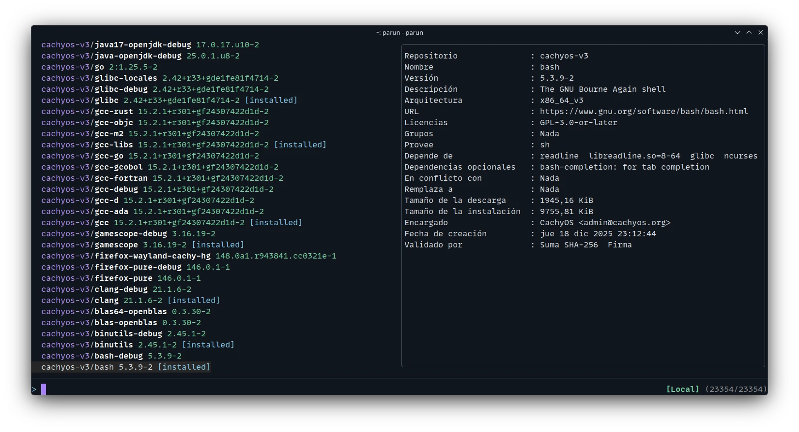

# parun

Parun is a terminal package manager for Pacman, the Arch User Repository (AUR), and Nimble. It combines real-time package search, package details, multi-selection, and batch operations in one interface.



## Documentation

- [Architecture](docs/architecture.md)
- [Development and verification](docs/development.md)
- [GitHub repository and releases](https://github.com/gabrielcapilla/parun)

## Install

```bash
curl -fsSL gabrielcapilla.github.io/install | bash -s parun
```

The release installer downloads a GitHub release and chooses the portable `x86_64` binary or the optimized `x86_64-v3` binary for the current CPU. Inspect the installer before piping it to a shell if you need to audit the installation step.

## Build from source

Local development uses Nim 2.4.0. The package manifest currently supports Nim 2.2.0 or newer. Source builds also require a C compiler and linker. The current runtime is intended for Linux systems with the package tools used by the selected source available on `PATH`.

```bash
git clone https://github.com/gabrielcapilla/parun.git &&
cd parun &&
nimble native &&
install -Dm755 parun "$HOME/.local/bin/parun"
```

Pacman operations use `pacman`, `paru`, or `yay` according to the executable detected at startup. Nimble operations use `nimble`, and Nimble package details use `curl` to fetch repository manifests. Index refreshes also use `curl` and `gunzip` for remote metadata.

## Usage

```bash
parun
```

Useful prefixes:

- `aur/` or `a/`
- `nim/`, `n/`, or `nimble/`
- `installed/` or `i/`

Useful keys:

- `F1`: toggle details
- `Up` / `Ctrl+K`: move up
- `Down` / `Ctrl+J`: move down
- `Tab`: select package
- `Enter`: install focused or selected packages
- `Ctrl+R`: remove selected packages
- `Ctrl+S`: review selected packages

Run `parun --help` for the complete option list, including animation settings, performance output, source filters, index refresh, and deterministic diagnostic commands.

## Headless diagnostics

Headless mode is intended for fast debugging and automation. It does not initialize the terminal or enter the TUI event loop; it emits one JSON result and exits with status 0 on success or a nonzero status on failure.

```bash
parun --headless --nimble --index-dir="$HOME/.cache/parun" --headless-query=nph --headless-rounds=1
parun --headless-detail=nimble/nph --index-dir="$HOME/.cache/parun"
```

The detail command reports the indexed summary and the complete manifest fields, including `Author` and `Depends On`, when the repository manifest is available. `--index-dir` is useful for testing a disposable fixture or an alternate index set. Runtime `.prix` indexes use the current v7 format only; older index versions are rejected and must be rebuilt.

## Nimble Tasks

```bash
nimble native
nimble baseline_x86_64
nimble baseline_x86_64_v3
nimble verify
```

The complete verification workflow, including formatting, module checks, standalone tests, headless CLI smoke tests, measurement-tool compilation, application builds, and documentation generation, is in [docs/development.md](docs/development.md).

---

## Repository and support

- [GitHub](https://github.com/gabrielcapilla/parun)
